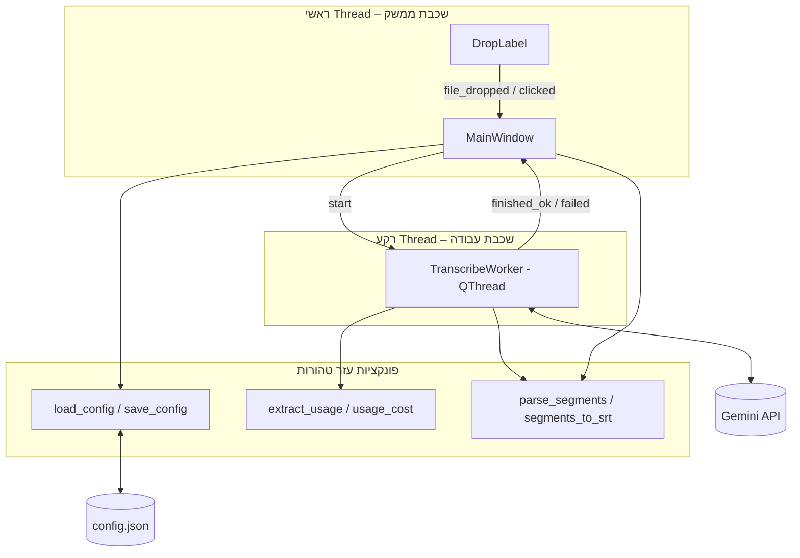
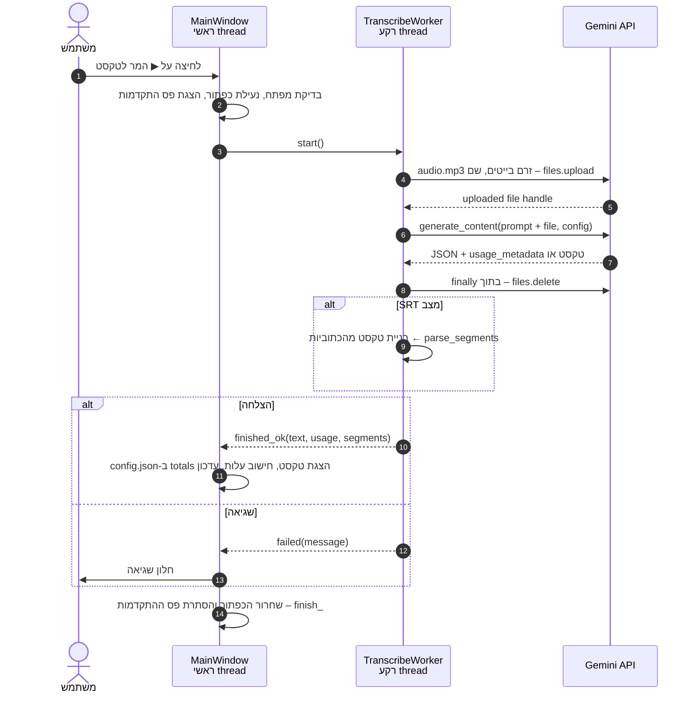
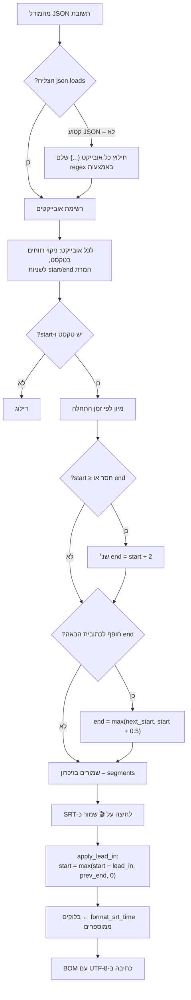
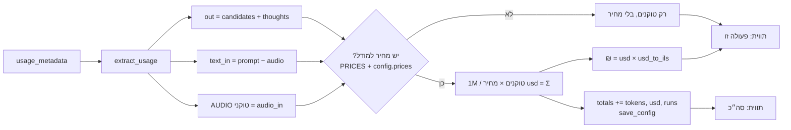

# Mp3toText – תיעוד הפרויקט

אפליקציית דסקטופ ל-Windows שממירה קובצי אודיו (MP3 ועוד) לטקסט באמצעות Gemini API של גוגל. אפשר גם ליצור ממנה קובץ כתוביות SRT עם חותמות זמן. הממשק בעברית, מימין לשמאל, עם תמיכה מלאה בטקסט דו-כיווני (עברית ואנגלית באותו מסמך).

**תוכן העניינים**

1. [התקנה](#1-התקנה)
2. [הפעלה ושימוש](#2-הפעלה-ושימוש)
3. [קובץ ההגדרות config.json](#3-קובץ-ההגדרות-configjson)
4. [מבנה הפרויקט](#4-מבנה-הפרויקט)
5. [תיאור הקוד](#5-תיאור-הקוד)
6. [תרשימי זרימה](#6-תרשימי-זרימה)
7. [החלטות תכנון](#7-החלטות-תכנון)
8. [פתרון תקלות](#8-פתרון-תקלות)

---

## 1. התקנה

**דרישות:**

- Windows 10 ומעלה
- Python 3.10 ומעלה
- מפתח Gemini API. הדרך הפשוטה להשיג אותו: https://aistudio.google.com/apikey ← **Create API key**

**התקנת הספריות** (מתוך תיקיית הפרויקט):

```bash
pip install -r requirements.txt
```

| ספרייה | תפקיד |
|---|---|
| `PySide6` | ממשק המשתמש (Qt), כולל גרירת קבצים ותמיכה בעברית מימין לשמאל |
| `google-genai` | ה-SDK הרשמי של גוגל לתקשורת עם Gemini |

---

## 2. הפעלה ושימוש

### הפעלה

- לחיצה כפולה על `run.bat`. הקובץ מפעיל את `app.py` עם `pythonw`, כך שלא נפתח חלון שורת פקודה.
- או משורת הפקודה:

```bash
python app.py
```

### מבנה החלון


**סרגל עליון (מימין לשמאל):** המר לטקסט · שפה · צור גם כתוביות (SRT) · סה״כ טוקנים ועלות · ↺ איפוס · 💳 חיוב · ⚙ מפתח API  
**באמצע:** אזור הגרירה, ומתחתיו תיבת הטקסט (פסקה בעברית מימין לשמאל, פסקה באנגלית משמאל לימין).  
**סרגל תחתון (מימין לשמאל):** העתק הכל · שמור כקובץ · הקדמה · שמור כ-SRT · נקה · עלות הפעולה האחרונה · סטטוס

### שלבי עבודה

1. **מפתח API (פעם אחת):** לוחצים **⚙ מפתח API** ומדביקים את המפתח. הוא נשמר ב-`config.json`. אפשר במקום זה להגדיר משתנה סביבה `GEMINI_API_KEY`. אין לך מפתח? בחלון המפתח יש כפתור **🔑 קבלת מפתח ב-Google AI Studio** שפותח את https://aistudio.google.com/api-keys.
2. **טעינת קובץ:** גוררים קובץ אודיו לחלון (לאזור הגרירה או לכל מקום בחלון), או לוחצים על אזור הגרירה ובוחרים קובץ. נתמכים: `mp3`, `wav`, `m4a`, `ogg`, `flac`, `aac`.
3. **שפה:** בוחרים את שפת הדיבור באודיו (עברית / English / Română). המודל מתמלל באותה שפה ולא מתרגם.
4. **כתוביות (לא חובה):** מסמנים **צור גם כתוביות (SRT)** אם רוצים גם חותמות זמן.
5. **המרה:** לוחצים **▶ המר לטקסט**. פס ההתקדמות פועל, והממשק נשאר זמין בזמן ההמרה.
6. **שימוש בתוצאה:**
   - אפשר לערוך את הטקסט ישירות בתיבה.
   - **📋 העתק הכל** מעתיק את כל הטקסט ללוח.
   - **💾 שמור כקובץ** שומר קובץ `.txt`. חלון השמירה נפתח בתיקייה של קובץ האודיו, עם אותו שם בסיס.
   - **🎬 שמור כ-SRT** (זמין רק אחרי המרה עם כתוביות) שומר קובץ `.srt` באותו אופן.
   - **הקדמה (ms):** מקדים את זמן ההופעה של כל כתובית, כי חותמות הזמן של Gemini נוטות לאחר מעט. ברירת המחדל היא 200ms. אם הכתוביות עדיין מאחרות, מגדילים את הערך.
   - **נקה** מוחק את הטקסט ואת הכתוביות.

### טוקנים ועלות

- **למעלה:** הסך הכולל מכל ההמרות (טוקנים, דולרים ושקלים). הסכום נשמר ב-`config.json`, והכפתור **↺** מאפס אותו.
- **💳 חיוב:** פותח בדפדפן את [דף החיוב של Google Cloud](https://console.cloud.google.com/billing). שם רואים את החיוב בפועל ואת אמצעי התשלום, ואפשר לקבוע תקציב והתראות. הסכום שמוצג באפליקציה הוא הערכה בלבד.
- **למטה:** העלות של ההמרה האחרונה. כשמרחפים מעליה מוצג פירוט: אודיו נכנס, טקסט נכנס ופלט.
- המחיר מחושב לפי המחירון של שכבה בתשלום. **בשכבה החינמית אין חיוב בפועל.**

| סוג טוקן | מחיר ל-1M טוקנים (`gemini-2.5-flash`) |
|---|---|
| אודיו נכנס | $1.00 |
| טקסט נכנס (ההנחיה) | $0.30 |
| פלט (התמלול) | $2.50 |

להערכה: דקת אודיו היא כ-1,900 טוקנים, כלומר שעת תמלול עולה כ-20 סנט.

---

## 3. קובץ ההגדרות config.json

הקובץ נוצר אוטומטית ליד `app.py` ומתעדכן מתוך הממשק. הוא מופיע ב-`.gitignore` כי הוא מכיל את המפתח.

| מפתח | ברירת מחדל | משמעות | נקבע מ- |
|---|---|---|---|
| `api_key` | – | מפתח Gemini | כפתור ⚙ |
| `lang` | `"he"` | שפת הדיבור: `he` / `en` / `ro` | תיבת השפה |
| `srt` | `false` | האם ליצור כתוביות | תיבת הסימון |
| `srt_lead_in_ms` | `200` | הקדמת הכתוביות במילישניות | שדה "הקדמה" |
| `totals` | `{tokens, usd, runs}` | הסך המצטבר | אוטומטי / ↺ |
| `model` | `"gemini-2.5-flash"` | שם המודל | עריכה ידנית |
| `usd_to_ils` | `3.7` | שער הדולר לשקל | עריכה ידנית |
| `prices` | – | דריסה או הוספה של מחירים למודל, לדוגמה `{"gemini-2.5-pro": {"audio_in": 1.25, "text_in": 1.25, "out": 10}}` | עריכה ידנית |

---

## 4. מבנה הפרויקט

```
Mp3toText/
├── app.py              # כל קוד האפליקציה (קובץ יחיד)
├── run.bat             # הפעלה בלחיצה כפולה (pythonw, בלי חלון קונסולה)
├── requirements.txt    # PySide6, google-genai
├── config.json         # הגדרות משתמש + מפתח (לא ב-git)
├── README.md           # תקציר והוראות מהירות
└── docs/
    └── DOCUMENTATION.md  # המסמך הזה
```

---

## 5. תיאור הקוד

כל הקוד נמצא בקובץ [`app.py`](../app.py) ובנוי בשלוש שכבות:



### 5.1 קבועים

| קבוע | תיאור |
|---|---|
| `CONFIG_PATH` | נתיב `config.json`, תמיד ליד `app.py` |
| `DEFAULT_MODEL` | `gemini-2.5-flash` |
| `AUDIO_EXTS` | מיפוי סיומת קובץ ← MIME type. משמש גם לבדיקה שהקובץ נתמך |
| `LANGUAGES` | קוד שפה ← (תווית בממשק, שם השפה באנגלית להנחיה) |
| `PROMPT` | ההנחיה לתמלול טקסט רגיל |
| `SRT_PROMPT` + `SRT_SCHEMA` | ההנחיה וסכמת ה-JSON לתמלול עם חותמות זמן. המודל מחזיר מערך של `{start, end, text}` |
| `MIN_SEG_SECONDS` / `DEFAULT_SEG_SECONDS` | אורך מינימלי (0.5 שנ׳) ואורך ברירת מחדל (2 שנ׳) לכתובית |
| `DEFAULT_LEAD_IN_MS` | הקדמת כתוביות ברירת מחדל (200ms) |
| `PRICES` / `DEFAULT_USD_TO_ILS` | מחירון ושער ברירת מחדל |
| `DROP_IDLE` / `DROP_HOVER` | עיצוב אזור הגרירה במצב רגיל ובזמן גרירה |

### 5.2 פונקציות עזר

| פונקציה | תפקיד |
|---|---|
| `load_config()` / `save_config(cfg)` | קריאה וכתיבה של `config.json` ב-UTF-8. קובץ פגום נקרא כהגדרות ריקות |
| `clean_key(key)` | מסירה מהמפתח תווים שאינם ASCII ורווחים, כמו סימני כיוון נסתרים שנדבקים בהעתקה |
| `lang_instruction(lang)` | בונה את ההוראה "האודיו בשפה X, תמלל ב-X ואל תתרגם" |
| `extract_usage(resp)` | מחלצת מ-`usage_metadata` את מספרי הטוקנים: אודיו נכנס, טקסט נכנס ופלט (כולל טוקני "חשיבה") |
| `usage_cost(usage, prices)` | מחשבת עלות בדולרים, או `None` אם אין מחיר למודל |
| `parse_timestamp(value)` | ממירה `MM:SS.mmm`, `HH:MM:SS,mmm` או מספר לשניות |
| `parse_segments(raw)` | ממירה את תשובת ה-JSON לרשימת `(start, end, text)` ממוינת ותקינה. ראו [תרשים 6.3](#63-עיבוד-כתוביות-ושמירת-srt) |
| `format_srt_time(seconds)` | שניות ← `HH:MM:SS,mmm` |
| `apply_lead_in(segments, lead_in)` | מקדימה את זמן ההתחלה של כל כתובית בלי לרדת מתחת ל-0 ובלי חפיפה עם הכתובית הקודמת. זמני הסיום לא משתנים |
| `segments_to_srt(segments, lead_in)` | בונה את טקסט קובץ ה-SRT |

### 5.3 המחלקה `TranscribeWorker(QThread)`

מבצעת את כל התקשורת מול Gemini ב-thread נפרד, כדי שהממשק לא ייתקע בזמן ההמרה.

- **קלט:** מפתח, שם מודל, נתיב קובץ, האם לייצר SRT, שפה.
- **אותות (Signals):**
  - `finished_ok(text, usage, segments)`: בהצלחה. `segments` ריק אם לא התבקשו כתוביות.
  - `failed(message)`: בשגיאה.
- **`run()`:**
  1. יוצרת `genai.Client`.
  2. מעלה את הקובץ ל-Files API כזרם בייטים עם שם ASCII קבוע (`audio.mp3`). ראו [7.1](#71-שם-קובץ-בעברית).
  3. בונה `GenerateContentConfig`: `temperature=0` ותקרת פלט של 65,536 טוקנים. במצב SRT מוגדרים גם `response_mime_type=application/json` ו-`response_schema`. במודלי flash מכובה ה"חשיבה" (`thinking_budget=0`).
  4. קוראת ל-`generate_content` עם ההנחיה והקובץ.
  5. מוחקת את הקובץ מהשרת (בבלוק `finally`, כך שזה קורה גם אם הייתה שגיאה).
  6. במצב SRT מפענחת את הכתוביות ובונה מהן את הטקסט להצגה.
  7. משדרת `finished_ok` או `failed`.

### 5.4 המחלקה `DropLabel(QLabel)`

אזור הגרירה. מקבל קבצים בגרירה (`dragEnterEvent` / `dropEvent`), משנה צבע בזמן ריחוף ומשדר:

- `file_dropped(path)`: כשנגרר קובץ.
- `clicked()`: בלחיצה, ואז נפתח חלון בחירת קובץ.

### 5.5 המחלקה `MainWindow(QMainWindow)`

החלון הראשי. מחזיקה את ההגדרות (`self.cfg`), את הקובץ הנוכחי (`self.file_path`), את ה-worker הפעיל (`self.worker`) ואת הכתוביות האחרונות (`self.segments`).

| קבוצה | מתודות | תיאור |
|---|---|---|
| בנייה | `__init__` | בניית הממשק: סרגל עליון, אזור גרירה, תיבת טקסט, סרגל תחתון |
| הגדרות | `on_srt_toggled`, `on_lang_changed`, `on_lead_changed` | כל שינוי בממשק נשמר מיד ל-`config.json` |
| מפתח | `get_api_key`, `ask_api_key` | המפתח נלקח מ-`config.json`, ואם אין שם, מ-`GEMINI_API_KEY` |
| טעינה | `browse`, `load_file`, `dragEnterEvent`, `dropEvent` | בדיקת סיומת, עדכון אזור הגרירה, איפוס כתוביות ישנות |
| המרה | `convert`, `_finish`, `on_done`, `on_error` | הפעלת ה-worker וטיפול בתוצאה. `self.worker` משמש גם כ"נעילה" שמונעת המרה כפולה |
| עלות | `prices_for`, `format_usage`, `update_total_label`, `reset_totals` | חישוב ותצוגה של טוקנים ועלות |
| פלט | `copy_all`, `save_text`, `save_srt`, `clear_output`, `set_segments` | העתקה, שמירה וניקוי |

### 5.6 `main()`

יוצרת `QApplication`, מגדירה כיוון RTL לכל האפליקציה (`Qt.RightToLeft`) וגופן Segoe UI, ומציגה את החלון.

---

## 6. תרשימי זרימה

### 6.1 זרימת המשתמש


### 6.2 תהליך ההמרה (Threads ו-API)



### 6.3 עיבוד כתוביות ושמירת SRT



### 6.4 חישוב עלות וסה״כ מצטבר



---

## 7. החלטות תכנון

### 7.1 שם קובץ בעברית
ה-SDK של Gemini שולח את שם הקובץ בכותרת HTTP, שבה מותרים רק תווי ASCII. קובץ בשם עברי נכשל בשגיאה `'ascii' codec can't encode`. **הפתרון:** הקובץ נפתח ונשלח כזרם בייטים עם `display_name` קבוע באנגלית (`audio.mp3`). הקובץ המקורי לא משתנה.

### 7.2 Qt במקום Tkinter
הגרסה הראשונה נכתבה ב-Tkinter. תיבת הטקסט שם מציגה כל שורה בכיוון בסיס משמאל לימין, ולכן סימני פיסוק הופיעו בצד הלא נכון וטקסט מעורב התבלבל. Qt (`QTextEdit`) מזהה את הכיוון של **כל פסקה בנפרד** לפי התו החזק הראשון: פסקה בעברית מוצגת מימין לשמאל, פסקה באנגלית משמאל לימין.

### 7.3 בידוד כיוון בתוויות העלות
בתוויות מימין לשמאל, צירוף כמו `$0.0053 ≈ ₪0.020` מתבלבל. החלק הכספי עטוף בתווי Unicode ‏`U+2066` (LRI) ו-`U+2069` (PDI), שמבודדים אותו ושומרים עליו משמאל לימין.

### 7.4 כיבוי "חשיבה"
בתמלול אין צורך ב"חשיבה" של המודל, וטוקני חשיבה מחויבים במחיר הפלט. במודלי flash מוגדר `thinking_budget=0`.

### 7.5 כתוביות כ-JSON מובנה
במקום לבקש מהמודל SRT כטקסט חופשי, מבקשים JSON לפי סכמה (`response_schema`). זה מאפשר בדיקה ותיקון של הזמנים: מיון, השלמת זמן סיום חסר ומניעת חפיפות. ב-JSON שנקטע (למשל בקובץ ארוך שהגיע לתקרת הפלט) נשמרים כל האובייקטים השלמים שהתקבלו.

### 7.6 הקדמת כתוביות
חותמות הזמן של Gemini נוטות לאחר במעט. ההקדמה מוחלת **רק בשמירה**, ולכן אפשר לשנות אותה ולשמור שוב בלי המרה נוספת.

### 7.7 SRT עם BOM
קובץ ה-SRT נשמר ב-`utf-8-sig`, כלומר UTF-8 עם BOM, כדי שנגנים ועורכים ישנים יזהו את הקידוד ויציגו עברית נכון.

### 7.8 מחיקת הקובץ מהשרת
הקובץ שהועלה ל-Files API נמחק מיד בתום ההמרה, בבלוק `finally`, גם אם הייתה שגיאה. כך האודיו לא נשאר בשרתי גוגל לאחר הצורך.

---

## 8. פתרון תקלות

| הודעה / תופעה | סיבה | פתרון |
|---|---|---|
| `'ascii' codec can't encode characters` | שם קובץ בעברית בגרסה ישנה, או תו נסתר במפתח | עדכון לגרסה הנוכחית (שתי הבעיות מטופלות) |
| `403 PERMISSION_DENIED ... SERVICE_DISABLED` | המפתח שייך לפרויקט Google Cloud שבו Gemini API לא מופעל (למשל מפתח של Translate) | ליצור מפתח ב-https://aistudio.google.com/apikey |
| `API key not valid` | מפתח שגוי | להזין מחדש דרך ⚙ מפתח API |
| `לא התקבל טקסט מהמודל` | המודל החזיר תשובה ריקה (קובץ שקט, חסימת תוכן) | לבדוק את הקובץ ולנסות שוב |
| `לא ניתן היה לפענח כתוביות` | תשובת ה-JSON לא תקינה | לנסות שוב. אם זה חוזר, להמיר בלי SRT |
| הכתוביות מאחרות או מקדימות | סטייה בחותמות הזמן של Gemini | לשנות את ערך "הקדמה" ולשמור שוב (בלי המרה מחדש) |
| תמלול קטוע בקבצים ארוכים מאוד | הגעה לתקרת הפלט (65,536 טוקנים) | לפצל את הקובץ לחלקים |
| המחיר מוצג אבל לא חויבתי | שימוש בשכבה החינמית | זה תקין: המחיר הוא הערכה לפי שכבה בתשלום |
