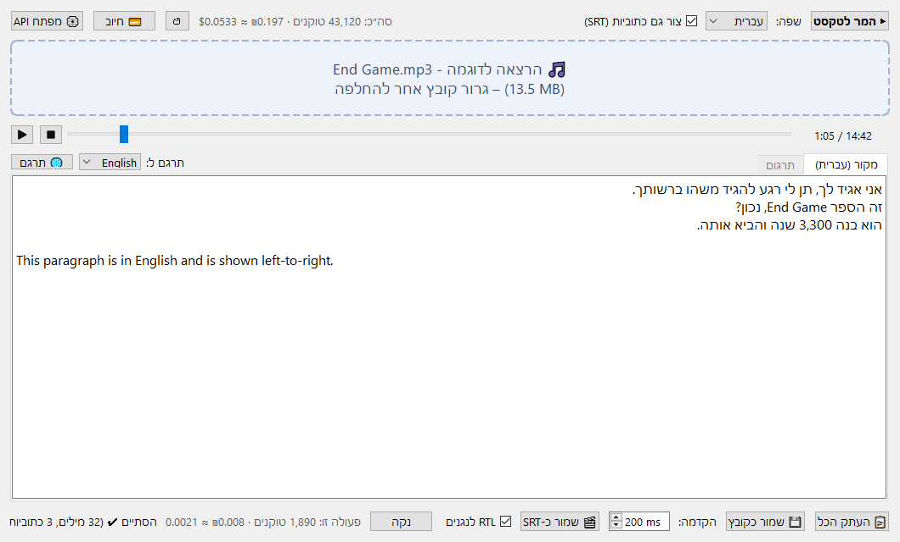
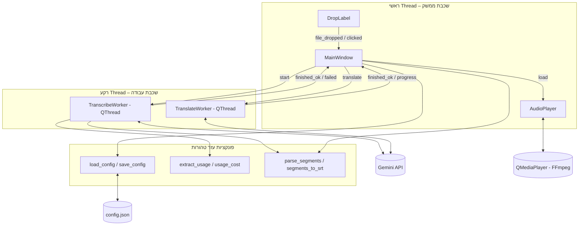
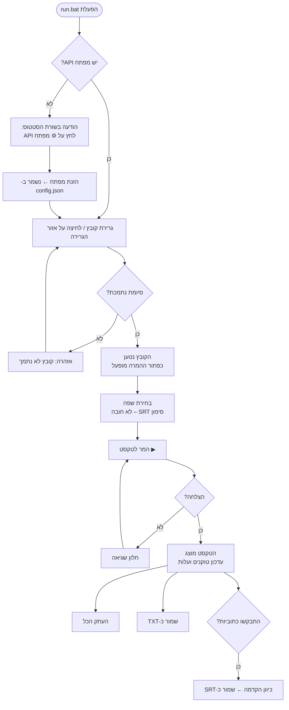
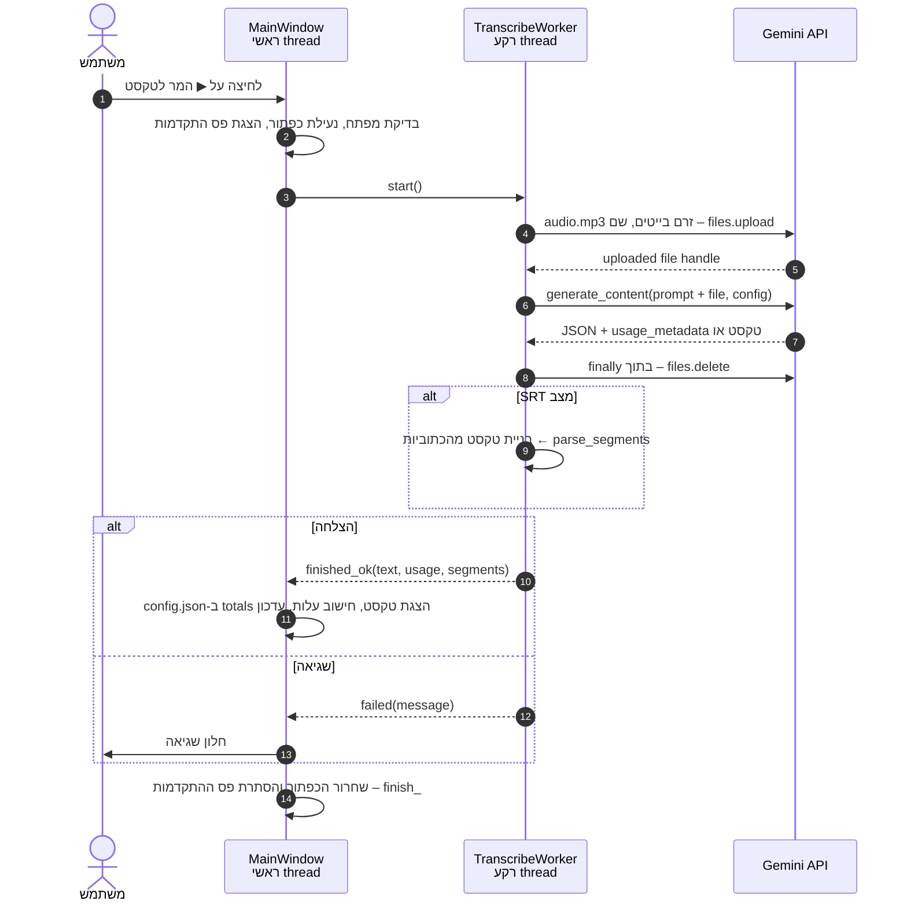
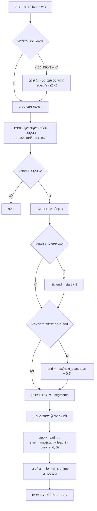
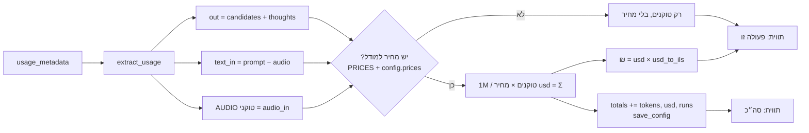
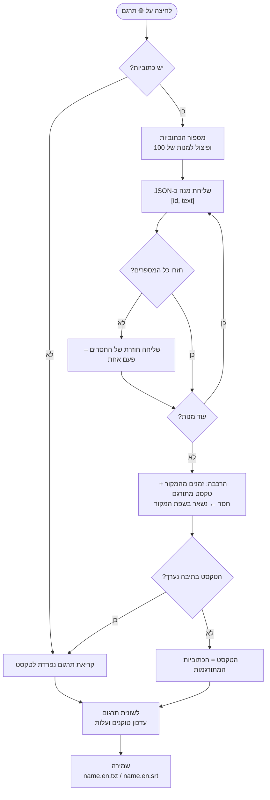

# Mp3toText – תיעוד הפרויקט

אפליקציית דסקטופ ל-Windows שממירה קובצי אודיו (MP3 ועוד) לטקסט באמצעות Gemini API של גוגל. אפשר גם ליצור ממנה קובץ כתוביות SRT עם חותמות זמן, ולתרגם את התמלול ואת הכתוביות לשפה אחרת. הממשק בעברית, מימין לשמאל, עם תמיכה מלאה בטקסט דו-כיווני (עברית ואנגלית באותו מסמך).

**תוכן העניינים**

1. [התקנה](#1-התקנה)
2. [הפעלה ושימוש](#2-הפעלה-ושימוש)
3. [קובץ ההגדרות config.json](#3-קובץ-ההגדרות-configjson)
4. [מבנה הפרויקט](#4-מבנה-הפרויקט)
5. [תיאור הקוד](#5-תיאור-הקוד)
6. [תרשימי זרימה](#6-תרשימי-זרימה)
7. [החלטות תכנון](#7-החלטות-תכנון)
8. [פתרון תקלות](#8-פתרון-תקלות)

---

## 1. התקנה

**דרישות:**

- Windows 10 ומעלה
- Python 3.10 ומעלה
- מפתח Gemini API. הדרך הפשוטה להשיג אותו: https://aistudio.google.com/apikey ← **Create API key**

**התקנת הספריות** (מתוך תיקיית הפרויקט):

```bash
pip install -r requirements.txt
```

| ספרייה | תפקיד |
|---|---|
| `PySide6` | ממשק המשתמש (Qt), כולל גרירת קבצים, תמיכה בעברית מימין לשמאל ונגן האודיו (QtMultimedia) |
| `google-genai` | ה-SDK הרשמי של גוגל לתקשורת עם Gemini |

---

## 2. הפעלה ושימוש

### הפעלה

- לחיצה כפולה על `run.bat`. הקובץ מפעיל את `app.py` עם `pythonw`, כך שלא נפתח חלון שורת פקודה.
- או משורת הפקודה:

```bash
python app.py
```

### מבנה החלון



**סרגל עליון (מימין לשמאל):** המר לטקסט · שפה · צור גם כתוביות (SRT) · סה״כ טוקנים ועלות · ↺ איפוס · 💳 חיוב · ⚙ מפתח API  
**באמצע:** אזור הגרירה, מתחתיו נגן האודיו (▶/⏸ · ⏹ · ציר זמן · זמן נוכחי / אורך כולל), ומתחתיו תיבת הטקסט עם שתי לשוניות, **מקור** ו**תרגום** (פסקה בעברית מימין לשמאל, פסקה באנגלית משמאל לימין). בקצה השמאלי של שורת הלשוניות: **תרגם ל:** ו-**🌐 תרגם**.  
**סרגל תחתון (מימין לשמאל):** העתק הכל · שמור כקובץ · הקדמה · שמור כ-SRT · RTL לנגנים · נקה · עלות הפעולה האחרונה · סטטוס

### שלבי עבודה

1. **מפתח API (פעם אחת):** לוחצים **⚙ מפתח API** ומדביקים את המפתח. הוא נשמר ב-`config.json`. אפשר במקום זה להגדיר משתנה סביבה `GEMINI_API_KEY`. אין לך מפתח? בחלון המפתח יש כפתור **🔑 קבלת מפתח ב-Google AI Studio** שפותח את https://aistudio.google.com/api-keys.
2. **טעינת קובץ:** גוררים קובץ אודיו לחלון (לאזור הגרירה או לכל מקום בחלון), או לוחצים על אזור הגרירה ובוחרים קובץ. נתמכים: `mp3`, `wav`, `m4a`, `ogg`, `flac`, `aac`.
3. **האזנה (לא חובה):** נגן האודיו שמתחת לאזור הגרירה מאפשר לשמוע את הקובץ שנטען:
   - **▶ / ⏸** מנגן או משהה.
   - **⏹** עוצר וחוזר להתחלה.
   - **ציר הזמן:** לחיצה על נקודה בציר קופצת אליה, ואפשר גם לגרור את הסמן. בזמן הגרירה מוצג זמן היעד, והקפיצה מתבצעת כשמשחררים.
   - **זמן נוכחי / אורך כולל** מוצג מימין לציר, למשל `1:05 / 14:42`.
4. **שפה:** בוחרים את שפת הדיבור באודיו (עברית / English / Română). המודל מתמלל באותה שפה ולא מתרגם.
5. **כתוביות (לא חובה):** מסמנים **צור גם כתוביות (SRT)** אם רוצים גם חותמות זמן.
6. **המרה:** לוחצים **▶ המר לטקסט**. פס ההתקדמות פועל, והממשק נשאר זמין בזמן ההמרה.
7. **שימוש בתוצאה:**
   - אפשר לערוך את הטקסט ישירות בתיבה.
   - **📋 העתק הכל** מעתיק את כל הטקסט ללוח.
   - **💾 שמור כקובץ** שומר קובץ `.txt`. חלון השמירה נפתח בתיקייה של קובץ האודיו, עם אותו שם בסיס.
   - **🎬 שמור כ-SRT** (זמין רק אחרי המרה עם כתוביות) שומר קובץ `.srt` באותו אופן.
   - **הקדמה (ms):** מקדים את זמן ההופעה של כל כתובית, כי חותמות הזמן של Gemini נוטות לאחר מעט. ברירת המחדל היא 200ms. אם הכתוביות עדיין מאחרות, מגדילים את הערך.
   - **RTL לנגנים** (מסומן כברירת מחדל): בשמירת כתוביות בעברית מוסיף לכל שורה סימני כיוון בלתי נראים, כדי שנגנים יציגו את הנקודה ואת סימן השאלה בצד הנכון ואת סדר המילים הנכון בשורה מעורבת. ראו [7.10](#710-סימני-כיוון-ב-srt).
   - **נקה** מוחק את הטקסט, הכתוביות והתרגום.
8. **תרגום (לא חובה):** אחרי התמלול בוחרים שפה ב-**תרגם ל:** (מופיעות רק השפות שאינן שפת המקור) ולוחצים **🌐 תרגם**.
   - התרגום מופיע בלשונית **תרגום (English)**, שנפתחת אוטומטית. אפשר לעבור בין הלשוניות בכל רגע.
   - הכפתורים **העתק הכל**, **שמור כקובץ** ו-**שמור כ-SRT** פועלים על הלשונית הפתוחה.
   - בשמירת תרגום שם הקובץ המוצע כולל את קוד השפה, למשל `הרצאה.en.txt` ו-`הרצאה.en.srt`. נגנים כמו VLC מזהים כך את שפת הכתוביות.
   - בכתוביות המתורגמות התזמון זהה למקור, וגם **הקדמה** חלה עליהן.
   - נשלח רק טקסט, בלי האודיו, ולכן התרגום מהיר וזול (בערך 1–2 סנט ל-15 דקות אודיו). העלות נכנסת לאותן תוויות.
   - תרגום ה-TXT כולל תיקונים ידניים שעשית בלשונית המקור. תרגום ה-SRT נעשה על הכתוביות כפי שהמודל החזיר אותן, כי תיקונים בתיבה לא משפיעים על הכתוביות.

### טוקנים ועלות

- **למעלה:** הסך הכולל מכל ההמרות (טוקנים, דולרים ושקלים). הסכום נשמר ב-`config.json`, והכפתור **↺** מאפס אותו.
- **💳 חיוב:** פותח תפריט עם שני קישורים, שנפתחים בדפדפן:
  - **חיוב – Google Cloud** ([console.cloud.google.com/billing](https://console.cloud.google.com/billing)): החיוב בפועל ואמצעי התשלום, ואפשר לקבוע שם תקציב והתראות. הסכום שמוצג באפליקציה הוא הערכה בלבד.
  - **מעקב אחר ניצול המכסה** ([ai.dev/rate-limit](https://ai.dev/rate-limit)): כמה בקשות נוצלו מהמכסה לדקה וליום, ומתי היא מתאפסת. במסלול החינמי המכסה של `gemini-2.5-flash` היא 20 בקשות ביום.
- **למטה:** העלות של ההמרה האחרונה. כשמרחפים מעליה מוצג פירוט: אודיו נכנס, טקסט נכנס ופלט.
- המחיר מחושב לפי המחירון של שכבה בתשלום. **בשכבה החינמית אין חיוב בפועל.**

| סוג טוקן | מחיר ל-1M טוקנים (`gemini-2.5-flash`) |
|---|---|
| אודיו נכנס | $1.00 |
| טקסט נכנס (ההנחיה) | $0.30 |
| פלט (התמלול) | $2.50 |

להערכה: דקת אודיו היא כ-1,900 טוקנים, כלומר שעת תמלול עולה כ-20 סנט.

---

## 3. קובץ ההגדרות config.json

הקובץ נוצר אוטומטית ליד `app.py` ומתעדכן מתוך הממשק. הוא מופיע ב-`.gitignore` כי הוא מכיל את המפתח.

| מפתח | ברירת מחדל | משמעות | נקבע מ- |
|---|---|---|---|
| `api_key` | – | מפתח Gemini | כפתור ⚙ |
| `lang` | `"he"` | שפת הדיבור: `he` / `en` / `ro` | תיבת השפה |
| `srt` | `false` | האם ליצור כתוביות | תיבת הסימון |
| `srt_lead_in_ms` | `200` | הקדמת הכתוביות במילישניות | שדה "הקדמה" |
| `translate_to` | השפה הראשונה ברשימה | שפת היעד האחרונה לתרגום | תיבת "תרגם ל:" |
| `srt_rtl_fix` | `true` | הוספת סימני כיוון לכתוביות בעברית | תיבת "RTL לנגנים" |
| `totals` | `{tokens, usd, runs}` | הסך המצטבר (תמלולים ותרגומים) | אוטומטי / ↺ |
| `model` | `"gemini-2.5-flash"` | שם המודל | עריכה ידנית |
| `usd_to_ils` | `3.7` | שער הדולר לשקל | עריכה ידנית |
| `prices` | – | דריסה או הוספה של מחירים למודל, לדוגמה `{"gemini-2.5-pro": {"audio_in": 1.25, "text_in": 1.25, "out": 10}}` | עריכה ידנית |

---

## 4. מבנה הפרויקט

```
Mp3toText/
├── app.py              # כל קוד האפליקציה (קובץ יחיד)
├── run.bat             # הפעלה בלחיצה כפולה (pythonw, בלי חלון קונסולה)
├── requirements.txt    # PySide6, google-genai
├── config.json         # הגדרות משתמש + מפתח (לא ב-git)
├── README.md           # תקציר והוראות מהירות
└── docs/
    └── DOCUMENTATION.md  # המסמך הזה
```

---

## 5. תיאור הקוד

כל הקוד נמצא בקובץ [`app.py`](../app.py) ובנוי בשלוש שכבות:



### 5.1 קבועים

| קבוע | תיאור |
|---|---|
| `CONFIG_PATH` | נתיב `config.json`, תמיד ליד `app.py` |
| `DEFAULT_MODEL` | `gemini-2.5-flash` |
| `AUDIO_EXTS` | מיפוי סיומת קובץ ← MIME type. משמש גם לבדיקה שהקובץ נתמך |
| `LANGUAGES` | קוד שפה ← (תווית בממשק, שם השפה באנגלית להנחיה) |
| `RTL_LANGS` | שפות מימין לשמאל (`he`), שלהן מוסיפים סימני כיוון ב-SRT |
| `PROMPT` | ההנחיה לתמלול טקסט רגיל |
| `SRT_PROMPT` + `SRT_SCHEMA` | ההנחיה וסכמת ה-JSON לתמלול עם חותמות זמן. המודל מחזיר מערך של `{start, end, text}` |
| `TRANSLATE_PROMPT` | ההנחיה לתרגום טקסט רגיל |
| `TRANSLATE_SRT_PROMPT` + `TRANSLATE_SRT_SCHEMA` | ההנחיה וסכמת ה-JSON לתרגום כתוביות: מקבלים ומחזירים מערך של `{id, text}` |
| `SRT_TRANSLATE_BATCH` | מספר כתוביות בכל בקשת תרגום (100), כדי שהתשובה לא תיקטע בקבצים ארוכים |
| `MIN_SEG_SECONDS` / `DEFAULT_SEG_SECONDS` | אורך מינימלי (0.5 שנ׳) ואורך ברירת מחדל (2 שנ׳) לכתובית |
| `DEFAULT_LEAD_IN_MS` | הקדמת כתוביות ברירת מחדל (200ms) |
| `PRICES` / `DEFAULT_USD_TO_ILS` | מחירון ושער ברירת מחדל |
| `DROP_IDLE` / `DROP_HOVER` | עיצוב אזור הגרירה במצב רגיל ובזמן גרירה |

### 5.2 פונקציות עזר

| פונקציה | תפקיד |
|---|---|
| `load_config()` / `save_config(cfg)` | קריאה וכתיבה של `config.json` ב-UTF-8. קובץ פגום נקרא כהגדרות ריקות |
| `clean_key(key)` | מסירה מהמפתח תווים שאינם ASCII ורווחים, כמו סימני כיוון נסתרים שנדבקים בהעתקה |
| `lang_instruction(lang)` | בונה את ההוראה "האודיו בשפה X, תמלל ב-X ואל תתרגם" |
| `extract_usage(resp)` | מחלצת מ-`usage_metadata` את מספרי הטוקנים: אודיו נכנס, טקסט נכנס ופלט (כולל טוקני "חשיבה") |
| `usage_cost(usage, prices)` | מחשבת עלות בדולרים, או `None` אם אין מחיר למודל |
| `parse_timestamp(value)` | ממירה `MM:SS.mmm`, `HH:MM:SS,mmm` או מספר לשניות |
| `parse_segments(raw)` | ממירה את תשובת ה-JSON לרשימת `(start, end, text)` ממוינת ותקינה. ראו [תרשים 6.3](#63-עיבוד-כתוביות-ושמירת-srt) |
| `format_srt_time(seconds)` | שניות ← `HH:MM:SS,mmm` |
| `apply_lead_in(segments, lead_in)` | מקדימה את זמן ההתחלה של כל כתובית בלי לרדת מתחת ל-0 ובלי חפיפה עם הכתובית הקודמת. זמני הסיום לא משתנים |
| `rtl_line(text)` | עוטפת שורת כתובית בסימני כיוון: RLM בשני הקצוות ו-RLE…PDF סביב הטקסט |
| `segments_to_srt(segments, lead_in, rtl)` | בונה את טקסט קובץ ה-SRT. עם `rtl=True` כל שורה עוברת דרך `rtl_line` |
| `parse_translations(raw)` | תשובת JSON של תרגום כתוביות ← מילון `{id: text}`. מצילה אובייקטים שלמים מ-JSON קטוע |
| `add_usage(total, usage)` | מחברת מוני טוקנים של כמה קריאות למודל |
| `format_clock(ms)` | מילישניות ← `M:SS` (או `H:MM:SS` משעה ומעלה), לתצוגת הזמן בנגן |

### 5.3 המחלקה `TranscribeWorker(QThread)`

מבצעת את כל התקשורת מול Gemini ב-thread נפרד, כדי שהממשק לא ייתקע בזמן ההמרה.

- **קלט:** מפתח, שם מודל, נתיב קובץ, האם לייצר SRT, שפה.
- **אותות (Signals):**
  - `finished_ok(text, usage, segments)`: בהצלחה. `segments` ריק אם לא התבקשו כתוביות.
  - `failed(message)`: בשגיאה.
- **`run()`:**
  1. יוצרת `genai.Client`.
  2. מעלה את הקובץ ל-Files API כזרם בייטים עם שם ASCII קבוע (`audio.mp3`). ראו [7.1](#71-שם-קובץ-בעברית).
  3. בונה `GenerateContentConfig`: `temperature=0` ותקרת פלט של 65,536 טוקנים. במצב SRT מוגדרים גם `response_mime_type=application/json` ו-`response_schema`. במודלי flash מכובה ה"חשיבה" (`thinking_budget=0`).
  4. קוראת ל-`generate_content` עם ההנחיה והקובץ.
  5. מוחקת את הקובץ מהשרת (בבלוק `finally`, כך שזה קורה גם אם הייתה שגיאה).
  6. במצב SRT מפענחת את הכתוביות ובונה מהן את הטקסט להצגה.
  7. משדרת `finished_ok` או `failed`.

### 5.4 המחלקה `TranslateWorker(QThread)`

מתרגמת את התמלול שכבר קיים, ב-thread נפרד. נשלח רק טקסט, בלי העלאת האודיו.

- **קלט:** מפתח, מודל, שפת מקור, שפת יעד, הטקסט שבלשונית המקור, הכתוביות.
- **אותות:** `finished_ok(text, usage, segments)`, `failed(message)`, `progress(status)` להודעות "חלק 2 מתוך 3".
- **`run()`:** ראו [תרשים 6.5](#65-תרגום).
  1. **כתוביות (אם יש):** ממספרת אותן ושולחת במנות של 100 כ-JSON. התשובה חייבת להחזיר את אותם מספרים.
  2. **`_translate_batch`:** מספרים שהמודל דילג עליהם נשלחים שוב פעם אחת. כתובית שלא חזרה גם אז נשארת בשפת המקור, והממשק מתריע על כתוביות שזהות למקור.
  3. **זמנים:** חותמות הזמן נלקחות מהמקור, ולכן התזמון זהה.
  4. **טקסט:** אם הטקסט בתיבה זהה לטקסט הכתוביות (לא נערך), התרגום שלו נבנה מהכתוביות המתורגמות, בלי קריאה נוספת. אם נערך, או שאין כתוביות, נשלחת קריאת תרגום נפרדת לטקסט.
  5. כל מוני הטוקנים מכל הקריאות מתחברים (`add_usage`) לעלות אחת.

### 5.5 המחלקה `DropLabel(QLabel)`

אזור הגרירה. מקבל קבצים בגרירה (`dragEnterEvent` / `dropEvent`), משנה צבע בזמן ריחוף ומשדר:

- `file_dropped(path)`: כשנגרר קובץ.
- `clicked()`: בלחיצה, ואז נפתח חלון בחירת קובץ.

### 5.6 המחלקות `AudioPlayer(QWidget)` ו-`SeekSlider(QSlider)`

נגן האודיו של הקובץ שנטען, מבוסס על `QMediaPlayer` ו-`QAudioOutput` מתוך QtMultimedia (חלק מ-PySide6, משתמש ב-FFmpeg המובנה). לא נדרשת ספרייה נוספת.

- **כיוון:** הנגן מוגדר `LeftToRight` גם בתוך הממשק העברי, כי הזמן בציר מתקדם משמאל לימין, כמו ברוב נגני המדיה.
- **`load(path)`:** עוצרת ניגון קודם, טוענת את הקובץ (`QUrl.fromLocalFile`, תומך בשמות בעברית) ומפעילה את הכפתורים. `MainWindow.load_file` קוראת לה בכל טעינת קובץ.
- **`toggle_play()`:** מנגנת או משהה. האייקון מתחלף לפי `playbackStateChanged` (`on_state`).
- **Stop:** `player.stop()` עוצר ומחזיר את המיקום ל-0.
- **סנכרון הציר:**
  - `durationChanged` ← `on_duration`: קובעת את טווח הציר במילישניות.
  - `positionChanged` ← `on_position`: מזיזה את הסמן ומעדכנת את הזמן, **אלא אם המשתמש גורר כרגע** (`isSliderDown`), כדי שהסמן לא "יקפוץ" לו מתחת ליד.
  - `sliderMoved` ← `on_slider_moved`: בזמן גרירה מציגה את זמן היעד.
  - `sliderReleased` ← `setPosition`: הקפיצה בפועל מתבצעת בשחרור.
- **`SeekSlider`:** `QSlider` רגיל זז בלחיצה על הציר רק בצעד קבוע. המחלקה דורסת את `mousePressEvent`, מחשבת את הערך שמתאים לנקודת הלחיצה (`QStyle.sliderValueFromPosition`) וקופצת אליו מיד, ואז ממשיכה כרגיל, כך שאפשר להמשיך ולגרור.

### 5.7 המחלקה `MainWindow(QMainWindow)`

החלון הראשי. מחזיקה את ההגדרות (`self.cfg`), את הקובץ הנוכחי (`self.file_path`), את ה-worker הפעיל (`self.worker`), את הכתוביות ושפת המקור (`self.segments`, `self.source_lang`), ואת התרגום (`self.trans_segments`, `self.trans_lang`).

| קבוצה | מתודות | תיאור |
|---|---|---|
| בנייה | `__init__` | בניית הממשק: סרגל עליון, אזור גרירה, נגן אודיו, תיבת טקסט, סרגל תחתון |
| הגדרות | `on_srt_toggled`, `on_lang_changed`, `on_lead_changed` | כל שינוי בממשק נשמר מיד ל-`config.json` |
| מפתח | `get_api_key`, `ask_api_key` | המפתח נלקח מ-`config.json`, ואם אין שם, מ-`GEMINI_API_KEY` |
| טעינה | `browse`, `load_file`, `dragEnterEvent`, `dropEvent` | בדיקת סיומת, עדכון אזור הגרירה, איפוס כתוביות ישנות, טעינת הקובץ לנגן |
| המרה | `convert`, `_start`, `_finish`, `on_done`, `on_error` | הפעלת ה-worker וטיפול בתוצאה. `self.worker` משמש גם כ"נעילה": בזמן פעולה אחת אי אפשר להתחיל תמלול או תרגום נוסף |
| תרגום | `translate`, `on_translated`, `refresh_targets`, `reset_translation`, `on_target_changed` | הפעלת `TranslateWorker`, מילוי לשונית התרגום, ורשימת שפות היעד (כל השפות חוץ משפת המקור) |
| לשוניות | `current_output`, `update_output_buttons` | מחזירה את התיבה, הכתוביות והשפה של הלשונית הפתוחה. כל פעולות הפלט עובדות דרכה |
| עלות | `record_usage`, `prices_for`, `format_usage`, `update_total_label`, `reset_totals` | חישוב ותצוגה של טוקנים ועלות |
| פלט | `copy_all`, `save_text`, `save_srt`, `default_save_path`, `clear_output`, `set_segments`, `on_rtl_toggled` | העתקה, שמירה וניקוי של הלשונית הפתוחה. בתרגום שם הקובץ כולל את קוד השפה (`.en.srt`) |

### 5.8 `main()`

יוצרת `QApplication`, מגדירה כיוון RTL לכל האפליקציה (`Qt.RightToLeft`) וגופן Segoe UI, ומציגה את החלון.

---

## 6. תרשימי זרימה

### 6.1 זרימת המשתמש



### 6.2 תהליך ההמרה (Threads ו-API)



### 6.3 עיבוד כתוביות ושמירת SRT



### 6.4 חישוב עלות וסה״כ מצטבר



### 6.5 תרגום



---

## 7. החלטות תכנון

### 7.1 שם קובץ בעברית
ה-SDK של Gemini שולח את שם הקובץ בכותרת HTTP, שבה מותרים רק תווי ASCII. קובץ בשם עברי נכשל בשגיאה `'ascii' codec can't encode`. **הפתרון:** הקובץ נפתח ונשלח כזרם בייטים עם `display_name` קבוע באנגלית (`audio.mp3`). הקובץ המקורי לא משתנה.

### 7.2 Qt במקום Tkinter
הגרסה הראשונה נכתבה ב-Tkinter. תיבת הטקסט שם מציגה כל שורה בכיוון בסיס משמאל לימין, ולכן סימני פיסוק הופיעו בצד הלא נכון וטקסט מעורב התבלבל. Qt (`QTextEdit`) מזהה את הכיוון של **כל פסקה בנפרד** לפי התו החזק הראשון: פסקה בעברית מוצגת מימין לשמאל, פסקה באנגלית משמאל לימין.

### 7.3 בידוד כיוון בתוויות העלות
בתוויות מימין לשמאל, צירוף כמו `$0.0053 ≈ ₪0.020` מתבלבל. החלק הכספי עטוף בתווי Unicode ‏`U+2066` (LRI) ו-`U+2069` (PDI), שמבודדים אותו ושומרים עליו משמאל לימין.

### 7.4 כיבוי "חשיבה"
בתמלול אין צורך ב"חשיבה" של המודל, וטוקני חשיבה מחויבים במחיר הפלט. במודלי flash מוגדר `thinking_budget=0`.

### 7.5 כתוביות כ-JSON מובנה
במקום לבקש מהמודל SRT כטקסט חופשי, מבקשים JSON לפי סכמה (`response_schema`). זה מאפשר בדיקה ותיקון של הזמנים: מיון, השלמת זמן סיום חסר ומניעת חפיפות. ב-JSON שנקטע (למשל בקובץ ארוך שהגיע לתקרת הפלט) נשמרים כל האובייקטים השלמים שהתקבלו.

### 7.6 הקדמת כתוביות
חותמות הזמן של Gemini נוטות לאחר במעט. ההקדמה מוחלת **רק בשמירה**, ולכן אפשר לשנות אותה ולשמור שוב בלי המרה נוספת.

### 7.7 SRT עם BOM
קובץ ה-SRT נשמר ב-`utf-8-sig`, כלומר UTF-8 עם BOM, כדי שנגנים ועורכים ישנים יזהו את הקידוד ויציגו עברית נכון.

### 7.8 מחיקת הקובץ מהשרת
הקובץ שהועלה ל-Files API נמחק מיד בתום ההמרה, בבלוק `finally`, גם אם הייתה שגיאה. כך האודיו לא נשאר בשרתי גוגל לאחר הצורך.

---

### 7.9 תרגום של התמלול, לא של האודיו
התרגום נעשה על הטקסט שכבר תומלל, ולא בהאזנה חדשה לאודיו. זה זול ומהיר יותר (רק טוקני טקסט), התוצאה תואמת בדיוק לתמלול שרואים, וב-SRT התזמון נשמר כמו שהוא. הכתוביות נשלחות ממוספרות כ-JSON, כדי לוודא שכל כתובית חזרה ולהתאים כל תרגום לזמנים שלו.

**הנחיה מפורשת "לתרגם הכול":** בלי זה המודל משמיט תוכן שהוא מפרש כרעש. לדוגמה, `1 2 3 שלום עולם.` תורגם ל-`Hello world.` בלבד (שוחזר 3 מתוך 3 עם `gemini-2.5-flash`). ההנחיה דורשת עכשיו לשמור כל מספר, ספירה, שם ומילת מילוי. אחרי השינוי מספרים, ספירה ומילות מילוי נשמרו בכל הבדיקות, באנגלית וברומנית.

### 7.10 סימני כיוון ב-SRT
נגנים רבים מציגים כתוביות בכיוון בסיס משמאל לימין, ולכן בעברית הנקודה וסימן השאלה מופיעים בצד הלא נכון, ובשורה מעורבת סדר המילים מתבלבל. `rtl_line` עוטפת כל שורה ב-RLM (`U+200F`) משני הצדדים וב-RLE…PDF (`U+202B`…`U+202C`) סביב הטקסט. זה נבדק במדידת מיקום התווים בשני מנועי טקסט שמוגדרים משמאל לימין (Qt ו-Chromium): בלי הסימנים הנקודה וסדר המילים שגויים, ועם הסימנים שניהם נכונים. נגנים שונים מממשים כיוון טקסט אחרת, ולכן אפשר לכבות את זה (תיבת "RTL לנגנים").

### 7.11 מכסת בקשות לדקה
במסלול החינמי של Gemini יש מגבלה של 5 בקשות לדקה למודל. תרגום כתוביות של קובץ ארוך שולח כמה בקשות ברצף, ולכן `call_with_quota_retry` מטפלת בשגיאת 429: היא ממתינה את הזמן שגוגל מבקש ("retry in Xs", עד 90 שניות), מציגה הודעה בשורת הסטטוס ומנסה שוב, עד 4 ניסיונות. כשנגמרת מכסה **יומית** אין טעם לחכות, ולכן השגיאה מוצגת מיד.

## 8. פתרון תקלות

| הודעה / תופעה | סיבה | פתרון |
|---|---|---|
| `'ascii' codec can't encode characters` | שם קובץ בעברית בגרסה ישנה, או תו נסתר במפתח | עדכון לגרסה הנוכחית (שתי הבעיות מטופלות) |
| `403 PERMISSION_DENIED ... SERVICE_DISABLED` | המפתח שייך לפרויקט Google Cloud שבו Gemini API לא מופעל (למשל מפתח של Translate) | ליצור מפתח ב-https://aistudio.google.com/apikey |
| `API key not valid` | מפתח שגוי | להזין מחדש דרך ⚙ מפתח API |
| "הגעת למכסת הבקשות לדקה – ממתין X שניות" | חריגה ממגבלת הבקשות לדקה (במסלול החינמי: 5 לדקה) | לא צריך לעשות כלום: האפליקציה ממתינה וממשיכה לבד |
| `429 RESOURCE_EXHAUSTED ... PerDay` | נגמרה המכסה היומית (במסלול החינמי: 20 בקשות ביום) | לבדוק מתי היא מתאפסת ב-💳 חיוב ← מעקב אחר ניצול המכסה. אפשר לחכות, או לחבר חשבון חיוב |
| התרגום השמיט מספרים או מילים | גרסה ישנה של ההנחיה | עדכון לגרסה הנוכחית (ההנחיה דורשת לתרגם הכול) |
| `לא התקבל טקסט מהמודל` | המודל החזיר תשובה ריקה (קובץ שקט, חסימת תוכן) | לבדוק את הקובץ ולנסות שוב |
| `⚠ X כתוביות זהות למקור (ייתכן שלא תורגמו)` | המודל לא החזיר תרגום לחלק מהכתוביות גם בניסיון החוזר, או שהכתובית זהה בשתי השפות (למשל שם) | לתרגם שוב. מה שנשאר מופיע בשפת המקור |
| כתוביות בעברית מוצגות בנגן עם סימני ריבוע או רווחים מוזרים | הנגן לא תומך בסימני הכיוון | לבטל את "RTL לנגנים" ולשמור שוב |
| `לא ניתן היה לפענח כתוביות` | תשובת ה-JSON לא תקינה | לנסות שוב. אם זה חוזר, להמיר בלי SRT |
| הכתוביות מאחרות או מקדימות | סטייה בחותמות הזמן של Gemini | לשנות את ערך "הקדמה" ולשמור שוב (בלי המרה מחדש) |
| תמלול קטוע בקבצים ארוכים מאוד | הגעה לתקרת הפלט (65,536 טוקנים) | לפצל את הקובץ לחלקים |
| המחיר מוצג אבל לא חויבתי | שימוש בשכבה החינמית | זה תקין: המחיר הוא הערכה לפי שכבה בתשלום |
